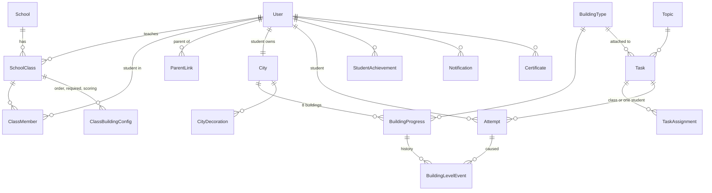

# Data model

Source of truth: [`prisma/schema.prisma`](../prisma/schema.prisma). It covers 29 tables in one SQLite file, `prisma/dev.db`. This page explains how the tables fit together and which spec rule each one serves.

## Map

## Groups

| Group | Tables | Spec |
|---|---|---|
| People | `User` (role: STUDENT / TEACHER / PARENT / ADMIN), `School`, `SchoolClass`, `ClassMember`, `ParentLink` | §2 |
| City | `City` (name and resource balances), `BuildingType` (the 8 buildings, reference data), `BuildingProgress` (level 0–5 per building), `BuildingLevelEvent` (level history) | §3, §4 |
| Class settings | `ClassBuildingConfig`: unlock order, required flag, unlock rule, scoring mode (BEST / AVERAGE / REQUIRED_ONLY) | §3, §4 |
| Content | `Topic`, `Task`, `TaskAssignment` (deadline and required flag per class or student), `AttemptAllowance` (extra retakes), `Material` (text/image/audio/video) | §2.2, §5 |
| Results | `Attempt`: every try is kept, with status IN_PROGRESS → PENDING_REVIEW → GRADED (or RETURNED) | §4, §5 |
| Rewards | `RewardTransaction` (points, materials and stars ledger), `Achievement` + `StudentAchievement`, `Decoration` + `CityDecoration` | §6 |
| Notifications | `Notification`: the 5 parent messages from §8, plus student and teacher events | §8 |
| Certificates | `CertificatePolicy` (tier thresholds; platform default + per-class override), `CertificateTemplate`, `Certificate` (serial, verify code, snapshot) | §7 |
| Platform | `PlatformSetting`, `AuditLog` (also used for login throttling), `ErrorLog` | §2.4, §11 |
| Auth | `Session`: one row per signed-in device; deleting it ends the session | §11 |

## Key rules

- **A building never goes down.** `BuildingProgress.level = max(old level, levelForScore(aggregate))`. See [`lib/domain/levels.ts`](../lib/domain/levels.ts). Every rise is stored as a `BuildingLevelEvent`, which parents see as the city's development history.
- **The full attempt history is kept.** `Attempt.number` counts tries per (task, student). Grading never deletes or overwrites an earlier attempt.
- **The answer key stays on the server.** `Task.answerKey` is never sent to the browser; the task player gets `Task.content` only.
- **Certificates expose no personal data.** `/verify/[verifyCode]` reads only `serial`, `tier`, `issuedAt` and `revokedAt`. The name and class live in `snapshot`, which only the PDF uses.
- **Parents are read-only.** Every parent query is scoped through `ParentLink`, so a parent sees only linked children (Stage 3 guards).

## JSON columns

SQLite has no list columns, so structured values are stored as JSON and validated with Zod:

| Column | Shape | Defined in |
|---|---|---|
| `Task.content` | `{ passage?, source?, questions: [...] }`, per type | [`lib/tasks/schemas.ts`](../lib/tasks/schemas.ts) |
| `Task.answerKey` | `{ [questionId]: key }`, auto-graded types only | same |
| `Task.criteria` | `[{ id, title, max }]`, where the maximums add up to 10 (manual types) | same |
| `Attempt.answers` | `{ [questionId]: answer }`, per type | [`lib/tasks/answers.ts`](../lib/tasks/answers.ts) |
| `Attempt.result` | `[{ questionId, correct, earned, max }]`, which drives the mistakes screen | [`lib/grading/grade.ts`](../lib/grading/grade.ts) |
| `Achievement.rule` | e.g. `{ type: "building_level", building: "grammar", level: 5 }` | Stage 8 |
| `Notification.payload` | values for the localized message, e.g. `{ building, level }` | Stage 9 |
| `Certificate.snapshot` | name, class and building levels at the moment of issue | Stage 11 |

Each task type's JSON shape is documented by example in [`prisma/seed/demo-tasks.ts`](../prisma/seed/demo-tasks.ts). It contains one demo task per type, and each is validated by the seed and by `npm test`.

## Changing the schema

1. Edit `prisma/schema.prisma`.
2. Run `npm run db:migrate -- --name short-description`. This creates `prisma/migrations/<timestamp>_short-description/` and regenerates the client.
3. If needed, update the seed and run `npm run db:seed`.

## Grading rules (auto-graded types)

Each question earns 0–1 and the task score is the average × 10, rounded to one decimal.

| Type | Rule |
|---|---|
| Single choice, character, text analysis (choice) | right or wrong |
| Multiple choice | (right picks − wrong picks) ÷ number of right options, never below 0 |
| Matching | share of correct pairs |
| Fill gaps, short answer | each gap compared ignoring case, spaces, ё/е and end punctuation; several accepted spellings |
| Word order | all or nothing |
| Error correction | (errors fixed − correct words changed) ÷ errors |
| Punctuation | (correct marks − extra marks) ÷ required marks |

Correct answers are shown on the result screen only after the last allowed attempt (otherwise a retake would just be copying). Which questions were wrong, and the explanation, are always shown.

## Building progression

After every graded attempt (on submit for closed tasks, or when the teacher grades an essay or recording), [`lib/grading/progress.ts`](../lib/grading/progress.ts):

1. Recomputes the building's score with the class's scoring mode ([`lib/domain/scoring.ts`](../lib/domain/scoring.ts)). Only tasks the student has a graded attempt for count:
   - **BEST:** the best score of each task, averaged over the tasks done.
   - **AVERAGE:** the average of every graded attempt, retakes included.
   - **REQUIRED_ONLY:** like BEST, but only required tasks count.
2. Sets `level = max(old level, levelForScore(score))`. The score itself may go down; the level never does.
3. On a level rise, writes a `BuildingLevelEvent` and notifies:
   - the student (`LEVEL_UP`, which plays the build animation once);
   - the parents (`NEW_BUILDING` for the first level).
4. Always notifies the parents with `TOPIC_RESULT`. Parents also get `DAILY_SUMMARY` at the 5th task of the day, and `COMPLETION_REMAINING` when the city crosses 50% and 80%.

The teacher's review either **grades** the work (rubric → score → steps 1–4, plus `WORK_GRADED` to the student) or **returns** it (`RETURNED`). A returned attempt doesn't count against the attempt limit.

## Task editor notation

Teachers never edit JSON. [`lib/tasks/authoring.ts`](../lib/tasks/authoring.ts) converts plain text into the stored task and back:

| Type | What the teacher types |
|---|---|
| Fill gaps | `пр[е]красный, [ещё/еще]`: `[answer/alternative]` |
| Error correction | `Вчера мы {видили\|видели} картины`: `{wrong\|correct/alternative}` |
| Punctuation | The correct sentence. The marks the teacher selects are removed and become the key |
| Word order | The correct sentence. The words are shuffled for the student |
| Matching | Pairs. The right column is shuffled |

Once a task has submitted answers, its questions and key are locked (old results reference them). Use **Duplicate** to change it.

## Rewards and decorations (spec §6)

Rules live in [`lib/rewards/rules.ts`](../lib/rewards/rules.ts) and are applied in `applyGradedAttempt` (and by the seed).

| Reward | Rule |
|---|---|
| Knowledge points | 10 × (new best score on the task − previous best). Retakes only pay the improvement |
| Building materials | 5 per building level gained; spent in the decoration shop |
| Mastery stars | 1 the first time a task reaches 9+ |
| Badges | `Achievement.rule`: `buildings_built`, `building_level`, `buildings_level`, `all_buildings`, `perfect_score`, `improved_retake` |

Decorations sit on 40 fixed street slots: 24 road midpoints and 16 crossings ([`components/city/engine/decorations.ts`](../components/city/engine/decorations.ts)). `CityDecoration.x/y` hold doubled slot coordinates, or `null` while the decoration is still in the inventory. They are cosmetic only and never affect scores, levels or completion.

## Notifications feed (spec §8)

`Notification` rows are created by grading and review (`lib/grading/progress.ts`, `lib/student/attempts.ts`, the review actions). [`lib/notifications-feed.ts`](../lib/notifications-feed.ts) lists them, and [`components/notifications/`](../components/notifications/) renders the localized message for each `type` from its `payload`. Every cabinet header has a bell with the unread count.

- **Parents:** the five spec messages (`NEW_BUILDING`, `DAILY_SUMMARY`, `TOPIC_RESULT`, `COMPLETION_REMAINING`, `CERTIFICATE_ISSUED`). Each links to the child's page.
- **Students:** `WORK_GRADED`, `WORK_RETURNED`, `ACHIEVEMENT_EARNED`. `LEVEL_UP` is not listed: it drives the one-time build animation on the city screen, which marks it as seen.
- **Teachers:** `REVIEW_NEEDED`, linking to the review screen.

E-mail delivery is a later adapter; the rows already hold everything a message needs.

## Analytics (spec §9)

- `lib/teacher/analytics.ts` → `getClassAnalytics(user, classId)` (asserts `assertTeachesClass`). The average and per-topic numbers use **graded attempts only**; "pending" is `PENDING_REVIEW` attempts on the class's tasks. Weeks start on Monday in Almaty time (UTC+5), and the last 8 weeks are shown.
- Attention flags per student: `low` (average < 5) and `idle` (no submission in 7 days, or none ever).
- `lib/student/history.ts` → `getLearningHistory(viewer, studentId)` (asserts `assertCanViewStudent`). It powers `/student/history`, and the parent child page reuses its `series`.
- Charts live in `components/charts/*` (no chart library). Each has a single series in `--sz-sky-600` (validated for contrast and chroma), hairline grid, hover/focus tooltips and a "show as table" `
`. `LineChart` sizes itself with a ResizeObserver and draws its SVG at `width="100%"` with a viewBox, so it never forces its grid track wider (this caused a mobile overflow).

## Certificates (spec §7)

- **Rules** (`lib/certificates/rules.ts`, pure and unit-tested):
  - A student is eligible when every *required* task assigned to them (via a class or personally, published) has a **graded** attempt.
  - Every *required* building (`ClassBuildingConfig.isRequired`) must also reach `policy.minBuildingLevel` (default L3).
  - **Final score** = the average of the required buildings' aggregate scores, rounded to 0.1.
  - **Tier**: the highest threshold reached (default bronze 6 / silver 7.5 / gold 8.5 / platinum 9.5). Below bronze → no certificate.
- **Policy**: `CertificatePolicy` with `classId` = that class's own thresholds (set on `/teacher/certificates`); the row with `classId = null` is the platform default (admin, Stage 12).
- **Issuing** (`issueIfEligible` in `lib/certificates/service.ts`):
  - It runs after every graded attempt (end of `applyGradedAttempt`, in its own short transaction) and after a teacher saves or resets thresholds.
  - A certificate is issued once. If the tier later goes **up**, a new one is issued and the old one gets `revokedAt` (its verify page then says "replaced").
  - Serial: `SZ-YYYY-NNNNNN`, numbered per year.
  - `verifyCode`: 12 random bytes in base64url.
  - `snapshot` freezes the name, class, school, building levels and template titles for the PDF.
  - Notifies the student (`CERTIFICATE_ISSUED` with no subject, shown as "you got…") and the parents (with subject).
- **PDF**: `GET /api/certificates/[id]/pdf?lang=kk|ru`.
  - Any viewer of the student may download it; for anyone else it returns 404.
  - It is drawn with `pdf-lib` and the fonts in `assets/fonts/`. The QR code (vector) points to `APP_URL/{locale}/verify/{verifyCode}`.
- **Verify page** `/[locale]/verify/[code]`: public and `noindex`. It shows only validity, serial, tier and date.

## Admin cabinet (spec §2.4, §11)

- **Data and actions:** reads are in `lib/admin/queries.ts` (each takes the viewer and calls `assertAdmin`). Writes are in `app/[locale]/admin/actions.ts` (each calls `authorize(["ADMIN"], { write: true })` and writes an audit entry).
- **Users:**
  - Create any role with a one-time temporary password (a new student also gets a city).
  - Edit names, role, school, locale and the active flag.
  - Changing the role or deactivating a user deletes their sessions.
  - Admins cannot demote or deactivate themselves.
  - A teacher who still has classes cannot change role.
  - Admins can also reset passwords, sign a user out everywhere, and link parent ↔ student.
- **Settings** (`lib/settings.ts`, stored in `PlatformSetting`). Only enforced settings exist:
  - `registration.studentsByInviteCode`: the `/join` page and actions.
  - `scoring.defaultMode`: new classes.
  - `auth.maxLoginFailures`: the login throttle.
- **Catalogue:**
  - `BuildingType.isCore` marks "main" buildings. A building counts for the certificate only if it is core **and** required by the class.
  - Achievement names and descriptions, and decoration names and prices, are editable.
  - Building names and art, and the score → level rule, come from code.
- **Certificates:**
  - Default thresholds (the `CertificatePolicy` row with `classId = null`) and template titles are editable.
  - Revoking sets `revokedReason = "REVOKED"` (a tier upgrade uses `"REPLACED"`). The verify page then says "revoked", and `issueIfEligible` will not re-issue for that student until an admin reinstates the certificate.
- **Logs:**
  - `AuditLog` can be filtered by action prefix and actor login.
  - `ErrorLog` is written by `lib/errors.ts`, both from `instrumentation.ts` (`onRequestError`: path without query, method, route, kind; never headers or bodies) and from caught background failures (e.g. the certificate check).
- **Backups:** `lib/admin/backups.ts` (`VACUUM INTO`, file names `sozqala-YYYYMMDD-HHMMSS[-n].db` validated by a regex). Downloads go through `/api/admin/backups/[name]`, which only admins can use.

## Tasks by grade

- Every `Task` has a `grade` (5–11). The migration `task_grade` filled existing tasks from the classes they were assigned to.
- A grade-N task can be assigned only to grade-N classes, or to students who are members of a grade-N class (`assignTask`). The editor offers only those targets.
- A task's grade can't change while it is assigned outside the new grade (`gradeAssigned`). To reuse a task for another grade, duplicate it.
- Defence in depth: `assignedTaskIds()` and the certificate check only count published tasks whose grade is one of the student's class grades. A wrong assignment row never reaches a student.

